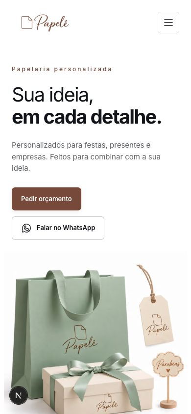
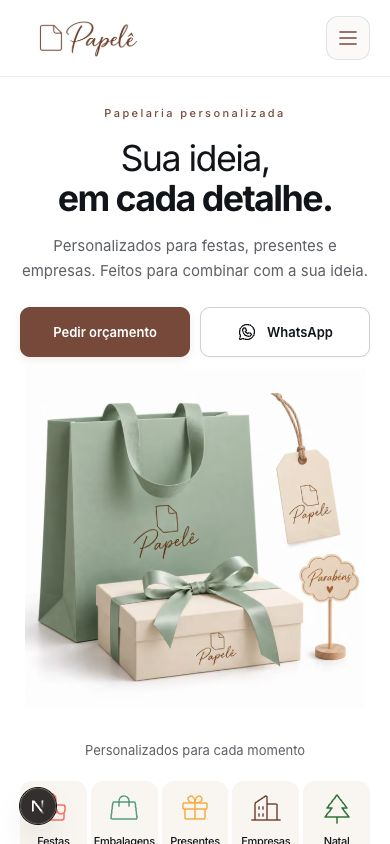
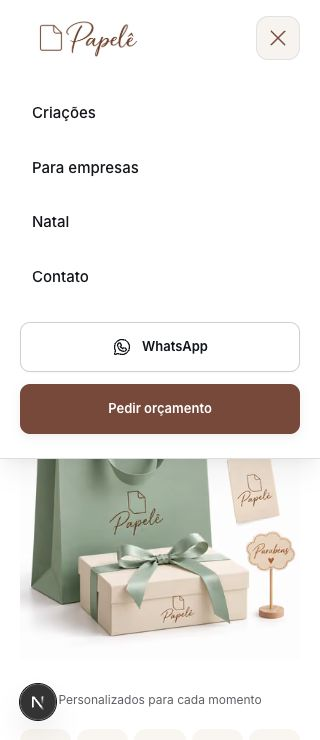
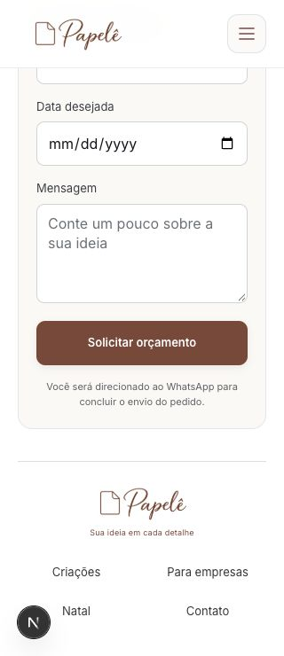
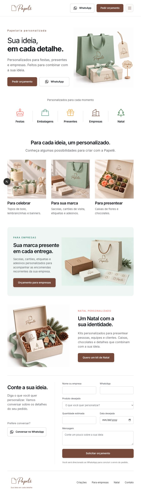

# Revisão e refinamento do mobile — Papelê

Revisão visual realizada em 27/10/2026 na página local em execução. Objetivo: melhorar leitura, composição e conforto em telas pequenas, preservando conteúdo, produtos, identidade e orçamento via WhatsApp.

## 1. Início e navegação — ajustados

O título ocupava três linhas em 320 px, e os botões empilhavam com larguras diferentes. O hero agora usa tipografia proporcional, texto centralizado no celular, ações de igual largura e imagem menor. O cabeçalho permanece disponível durante a rolagem abaixo de 1024 px, com deslocamento das âncoras ajustado para sua altura.

O menu aberto foi inspecionado em 320 px: links e ações ficam visíveis, com área rolável para alturas menores.

## 2. Categorias e vitrine — ajustadas

A distribuição de três categorias seguida de duas deixava espaço vazio. As cinco agora aparecem em uma linha, em áreas de toque com 80 px de altura. As legendas usam 10–11 px no celular para acomodar “Embalagens”; esse tamanho é uma limitação das cinco colunas na menor largura.

Os cards receberam borda sutil, cantos arredondados e indicação de acesso. As fotos usam proporção 6:5 abaixo de 640 px, com enquadramento deslocado para preservar o topo dos produtos. A partir de 640 px, a vitrine usa três colunas; a apresentação desktop mantém fotos quadradas.

## 3. Empresas e Natal — ajustados

No celular, textos e imagens ficam agrupados em painéis com espaçamento consistente e botões de largura completa. A fotografia de empresas ocupa toda a largura do painel. As duas seções voltam à composição em colunas a partir de 768 px.

## 4. Contato e formulário — ajustados

O formulário recebeu uma superfície discreta, campos com pelo menos 50 px de altura e fonte de 16 px abaixo de 768 px. Quantidade e data ficam em linhas separadas abaixo de 420 px, evitando comprimir a data; a partir dessa largura podem dividir a linha. Nome e WhatsApp dividem a linha a partir de 640 px.

A região de status vazia não reserva uma linha adicional. O rodapé usa duas colunas de navegação no celular. Os campos permaneceram vazios durante a revisão; o envio não foi acionado.

## 5. Transição para tablet — ajustada

Em 768 px, as margens negativas aproximavam a fotografia do texto do hero. Elas agora só são aplicadas a partir de 1280 px, com espaço entre as colunas nas larguras intermediárias. As ações do hero mantêm tamanhos iguais e usam o rótulo curto “WhatsApp” abaixo de 1024 px.

## Evidências e limites

- Largura do documento igual à viewport em 320, 390, 430, 768 e 1280 px nas observações realizadas.
- [Página completa antes, 390 px](mobile-review/before-full-390.jpg).
- [Página completa depois, 390 px](mobile-review/after-full-390.jpg).
- [Página completa depois, 430 px](mobile-review/after-full-430.jpg).
- [Título antes, 320 px](mobile-review/before-hero-320.jpg).

Capturas são evidência visual, não prova de conformidade completa de acessibilidade. Aparelhos físicos, teclado virtual, leitores de tela e envio final no WhatsApp não foram avaliados. Não foram criados ou executados testes automatizados; ESLint e TypeScript são as validações estáticas usadas. A prévia permaneceu ligada, e o tamanho temporário da viewport foi restaurado ao final.
